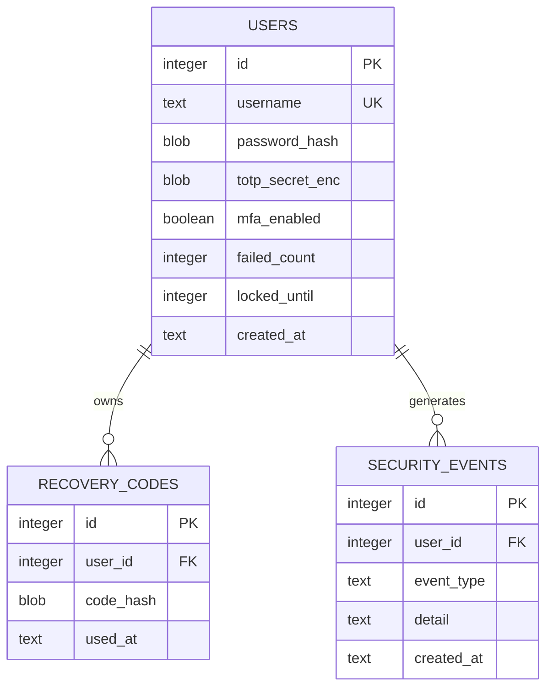
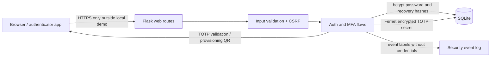

# Multi-Factor Authentication Demo System

A local, educational Flask app demonstrating password + TOTP authentication and one-use recovery codes. It uses SQLite and is intended for synthetic accounts on a loopback interface. It is **not production-ready** and must not be exposed publicly or used with real credentials.

## Start here

Architecture: browser → Flask routes and session/CSRF controls → authentication and MFA services → SQLite. Passwords and recovery codes are bcrypt hashes; TOTP secrets are Fernet-encrypted. TOTP uses RFC 6238 parameters with a configurable ±step window. QR enrollment uses an `otpauth://` URI that common authenticator apps understand.

Technology: Python 3.10+, Flask, SQLite, bcrypt, `cryptography` Fernet, and `qrcode`. The app binds to `127.0.0.1`. The signed Flask session is a client-side cookie; therefore its contents are signed, not encrypted. It holds only transient enrollment data and session state. Configure a unique, random `FLASK_SECRET_KEY` and Fernet key.

### Database design



### Architecture



### Threat model

| Asset / threat | Mitigation in this demo | Remaining risk / follow-up |
|---|---|---|
| Password database theft | bcrypt with cost 12; minimum 12 characters | Tune work factor to hardware; consider Argon2id and breached-password screening |
| Password reuse or phishing | TOTP second factor and single-use recovery codes | TOTP is phishable; prefer WebAuthn/passkeys for stronger assurance |
| Online password or OTP guessing | Per-account failure counter and temporary lockout, configurable threshold/window | Distributed abuse, DoS via lockout, and concurrent requests need production-grade rate limiting and monitoring |
| TOTP database theft | TOTP seed encrypted using Fernet | Key is configured separately but key rotation/managed key storage are not implemented |
| CSRF / session fixation | Per-session synchronizer token on POST; session cleared and rotated at authentication; HttpOnly, SameSite=Lax cookie | HTTPS and Secure cookie required beyond local loopback; no reverse-proxy deployment configuration |
| Account enumeration | Generic login failure message; generic duplicate-registration failure | Timing and registration responses are not fully equalized |
| Sensitive data leakage | Event log avoids passwords, OTPs, seeds, and recovery codes; recovery codes only displayed once | Local signed cookie is not encrypted; transient enrollment seed lives in it. Use server-side sessions before any real deployment |
| SQL injection / malformed input | Parameterized queries, constrained username and input lengths | Requires further code review and broader validation |
| Recovery code theft/reuse | Codes use random entropy, bcrypt hashes, and atomic one-use update | No user-facing regeneration flow; protect backups and local machine |
| Local database/log disclosure | Loopback-only app, `.gitignore` excludes DB | At-rest encryption of whole SQLite database, backups, file ACLs, retention policy, and tamper-evident logs are outside scope |

### Milestones

1. **Foundation:** environment setup, database schema, input validation, and registration.
2. **Password authentication:** bcrypt, generic login feedback, cookie settings, CSRF, and lockout.
3. **MFA enrollment:** password re-authentication, QR provisioning, encrypted seed, and TOTP confirmation.
4. **Recovery and account controls:** one-use recovery codes, MFA disable with password re-authentication, login verification, and event log.
5. **Review and demo:** run the test plan, inspect events, explain limitations, and prepare a short demo.

## Setup

1. Install Python 3.10 or newer.
2. In this folder, create an environment and install dependencies:

   ```powershell
   py -m venv .venv
   .\.venv\Scripts\Activate.ps1
   python -m pip install -r requirements.txt
   ```

3. Generate two independent keys. In PowerShell:

   ```powershell
   python -c "import secrets; print(secrets.token_urlsafe(48))"
   python -c "from cryptography.fernet import Fernet; print(Fernet.generate_key().decode())"
   ```

4. Set environment variables in the current PowerShell window (do not commit the values):

   ```powershell
   $env:FLASK_SECRET_KEY = "<first generated value>"
   $env:MFA_FERNET_KEY = "<second generated value>"
   $env:COOKIE_SECURE = "0"
   python app.py
   ```

5. Open `http://127.0.0.1:5000`. Register synthetic data and enroll a TOTP authenticator. Keep recovery codes private.

Changing `MFA_FERNET_KEY` makes existing encrypted TOTP seeds unreadable. Back up the local SQLite file and key together if you want to preserve demo accounts. Do not reuse the example values. For HTTPS deployments, set `COOKIE_SECURE=1`, but this is not deployment guidance; obtain an independent security review first.

## User guide

Register a username containing 3–32 letters, numbers, `_`, `.`, or `-`, and a password at least 12 characters long. Sign in, open **Set up authenticator**, re-enter your password, scan the QR using an authenticator app, and confirm a current six-digit code. Save the eight displayed recovery codes in a private place. On later sign-ins, use a current TOTP or one unused recovery code. Each recovery code can be used once. Disable MFA from the dashboard only after password re-authentication.

TOTP permits the current time step plus or minus one 30-second step by default (about a 90-second acceptance span). Adjust `TOTP_WINDOW` to 0, 1, or 2 and `TOTP_STEP_SECONDS` to 30 or more. A wider window is more forgiving but accepts more candidate codes.

## Implemented protections and scope gaps

Implemented: bcrypt hashes, encrypted TOTP seed, QR provisioning URI, time-window verification, one-use recovery codes, password re-authentication for enrollment/disable, account lockout for password and MFA failures, HttpOnly/SameSite cookies, POST CSRF tokens, session rotation, server-side constraints, generic login errors, and basic event logging.

Not implemented or not suitable for production: HTTPS termination, encrypted server-side sessions, WebAuthn, email/password reset, account recovery support, distributed rate limiting, lockout alerts, secure secret rotation, database encryption/backup lifecycle, deployment hardening, privacy/retention controls, and independent security review. This demo has not been independently reviewed and makes no production security claim.

## Test plan

| Scenario | Expected result |
|---|---|
| Register valid user; use invalid username or short password | Valid account created; invalid inputs rejected with clear guidance |
| Register duplicate username | Generic create-account failure; no account details leaked |
| Password sign-in for non-MFA account | Dashboard appears; event says password-only login |
| Wrong username or password | Same generic sign-in error |
| Exceed password failure limit | Temporary lockout; further attempts receive generic error |
| Enroll MFA with wrong password | Enrollment not enabled |
| Scan QR; confirm correct TOTP | MFA enabled; recovery codes displayed once |
| Submit invalid TOTP or expired-outside-window code | Verification rejected |
| Sign in with valid TOTP | Dashboard appears and MFA success is logged |
| Sign in with one recovery code, then reuse it | First succeeds; reuse is rejected |
| Exceed MFA failure limit | Temporary account lockout |
| Disable MFA with wrong/right password | Wrong rejected; right disables MFA and invalidates recovery codes |
| POST without valid CSRF token | HTTP 400; state unchanged |
| Inspect events and DB | No raw password, OTP, TOTP secret, or recovery code in event data; encrypted seed and hashes in DB |
| Inspect session cookie attributes | HttpOnly and SameSite=Lax; Secure enabled when configured for HTTPS |

## Demo script (3–5 minutes)

1. Register a synthetic account and show the dashboard says “Password only”.
2. Enroll an authenticator, scan the QR, verify a code, and explain the encrypted seed and one-time recovery codes.
3. Sign out, sign in with the password, then complete the second-factor step.
4. Demonstrate that a recovery code works once and fails when reused (use a fresh account/code for a clean run).
5. Trigger a few failed attempts to show the temporary lockout, then point out the event log.
6. Close by discussing TOTP phishing, key management, distributed throttling, and why this local project is not production-ready.
